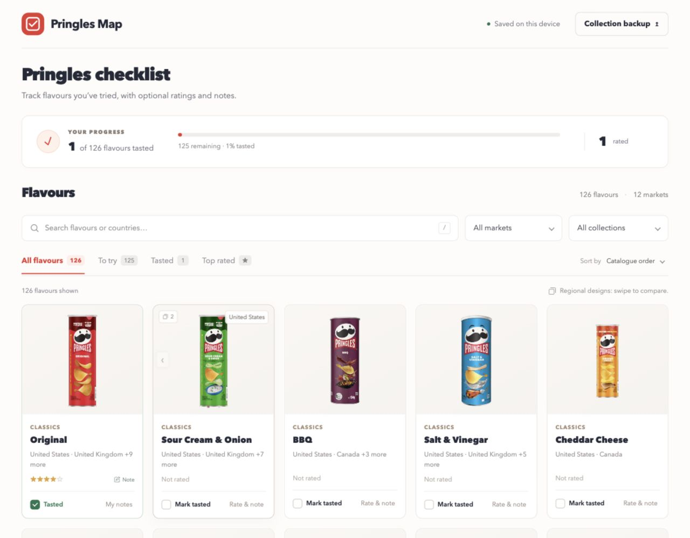

# Pringles Map

A personal checklist of Pringles flavours, with ratings and notes saved in your browser. Made for fun, unaffiliated with Pringles, with no sponsorship, advertising or sales.

[](https://github.com/ZhekLu/pringles-map/actions/workflows/pages.yml?query=branch%3Amain)
[](https://github.com/ZhekLu/pringles-map/actions/workflows/pages.yml?query=branch%3Amain)
[](https://react.dev/)
[](https://www.typescriptlang.org/)
[](https://vite.dev/)
[](.github/workflows/pages.yml)

[](https://zheklu.github.io/pringles-map/)



## Using the checklist

- Search the 126 entries by flavour or country, filter by market, and mark flavours as tasted.
- Regional progress appears after you taste a flavour available only within that region.
- Optionally give a 1-5 rating or add a note. Rating a flavour also marks it as tasted; unchecking it keeps your rating and note.
- Each flavour has one can photo. Only distinct regional designs get a gallery, labelled by region. Tap any photo to enlarge it.
- Download a JSON backup to keep your entries or move them to another browser. CSV export and printing are also available.

There is no account or backend. Entries use `localStorage` under `pringles-map.collection.v1`. Clearing browser data removes them, so keep a backup if you want to retain them. Imports update matching flavours and keep other entries.

## Run locally

Requires **Node.js 24 or newer**.

```sh
npm ci
npm run dev
```

```sh
npm test          # Collection behavior tests
npm run build    # Type-check, validate data/images, and compile to dist/
npm run preview  # Preview the compiled site
```

## Maintaining the catalogue

`data/catalogue.json` contains the flavours, source links, image credits and regional market groups.
Photos are stored in `public/assets/cans/`. Flavour IDs are kept stable so existing saved entries continue to match.
